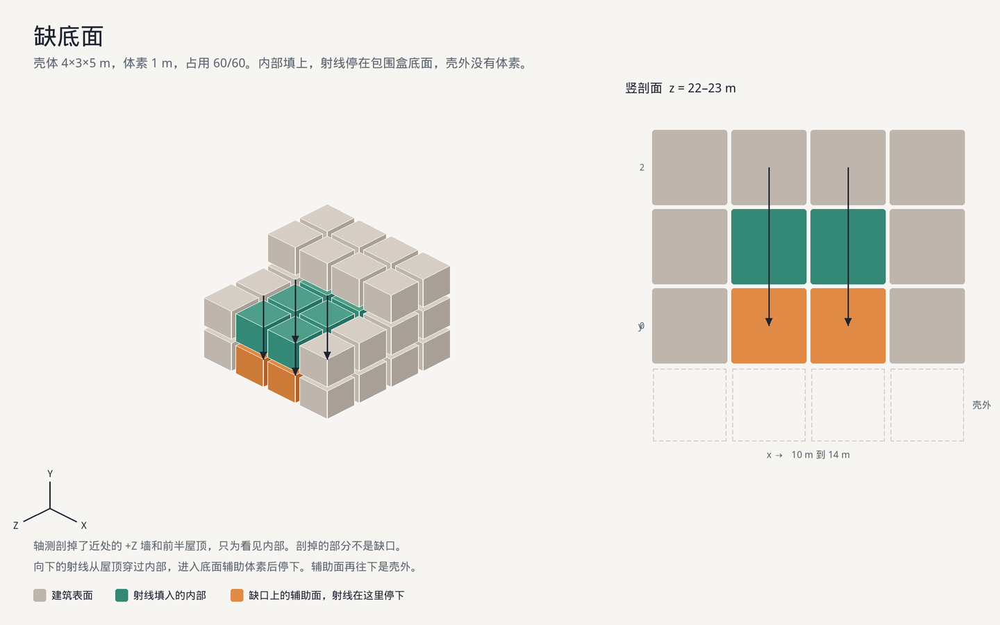
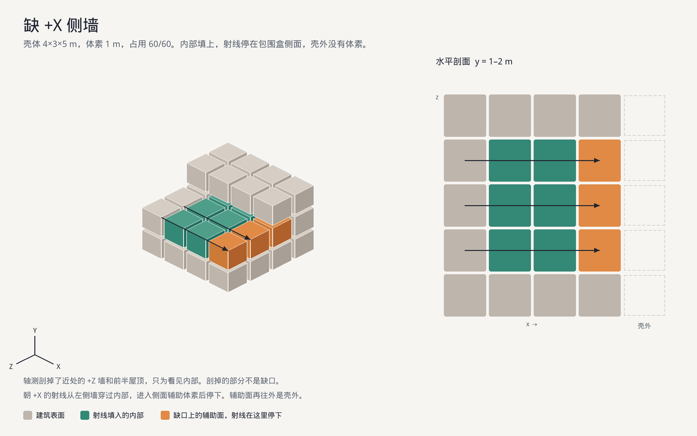

# beidou_vdb

检查建筑占用体素方案是否按写好的规则工作。

输入是 glTF 网格。多个 mesh 先乘上节点变换，变到同一坐标系。三角形正面是外表面。体素是边长 1 m 的立方体。全部顶点的轴对齐包围盒做成六面辅助网格，和建筑三角面一样挡射线。从每个建筑表面体素出发，沿外法线的反方向一格一格走，碰到下一张表面（建筑或辅助面）就停下。起点和落点之间的体素标成占用，表面体素本身也算占用。辅助面只补缺口，不把整个盒子直接标成占用。

仓库里没有现成的建筑 glTF。`cases/` 里有两个合成壳体：

- `shell_missing_floor.gltf`：没有底面
- `shell_missing_wall.gltf`：没有 +X 侧墙

两个文件都把墙、顶（和底）拆成不同 mesh，再用父节点平移到世界坐标。屋顶节点用矩阵把局部 y = 0 的面抬到壳体顶部，用来确认填充前已经合成到同一坐标系。

## 运行

在仓库根目录：

```bash
python3 -m pip install -r requirements.txt
python3 -m beidou_vdb
```

需要 Python 3 和 numpy。程序会读 `cases/` 里的两个 glTF，打印每种缺口的三件事：内部有没有填上、缺口有没有停在包围盒、壳外有没有渗漏。

## 结果

灰是建筑表面，绿是射线填进去的内部，橙是缺口上的包围盒辅助面。射线画到橙色体素就停。虚线格子是壳外，里面没有占用。轴测图剖掉近处的墙和半边屋顶，只为看见内部。

缺底面。向下的射线停在底面，底面下面是空的。



缺 +X 侧墙。朝侧面的射线停在橙色辅助面上，没有进入右边的壳外。



重新生成这两个图（需要 Pillow，不参与填充本身）：

```bash
python3 -m pip install pillow
python3 -m beidou_vdb.viz
```

重新生成这两个 glTF：

```bash
python3 -m beidou_vdb.synthetic
```
